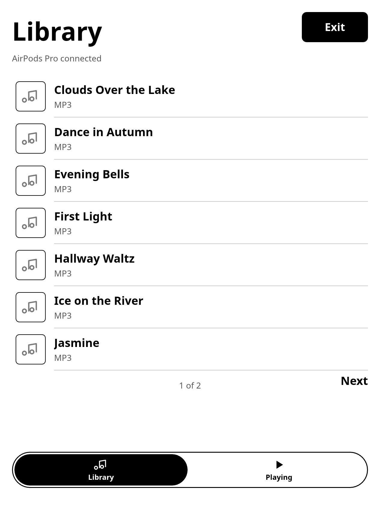
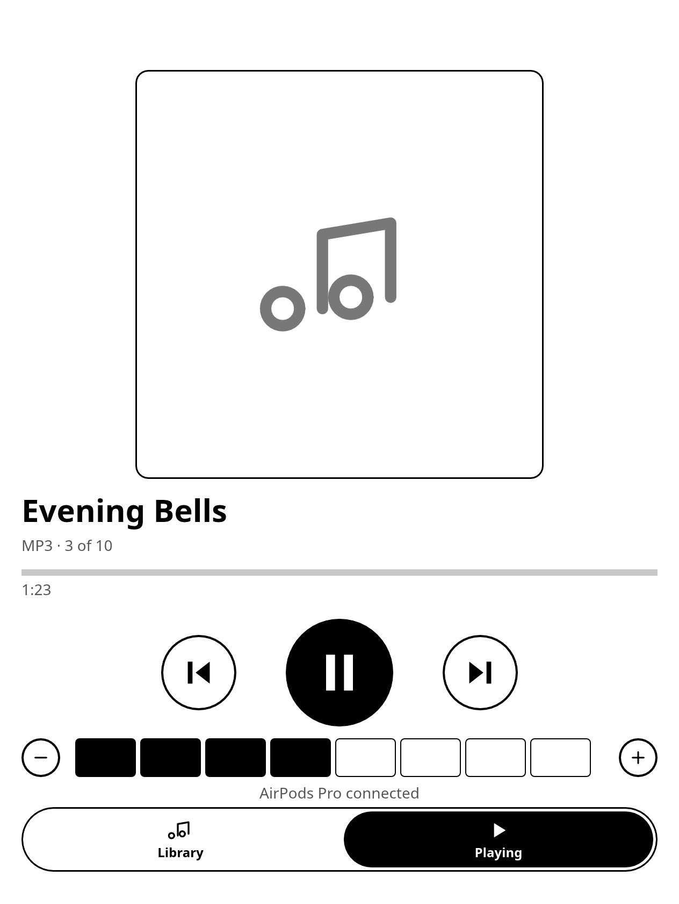
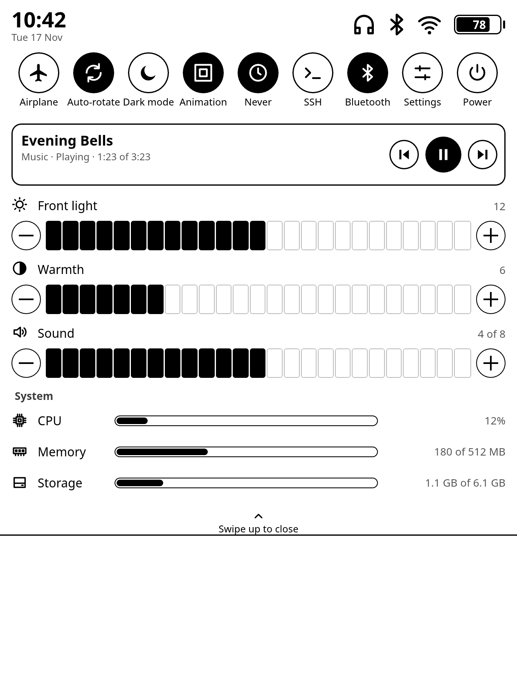
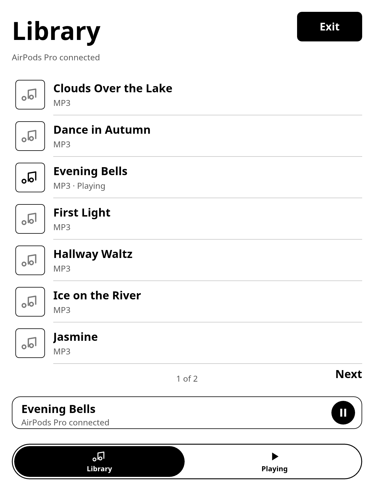
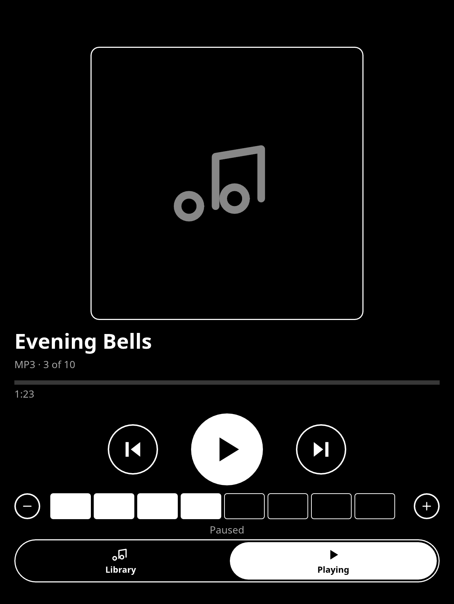
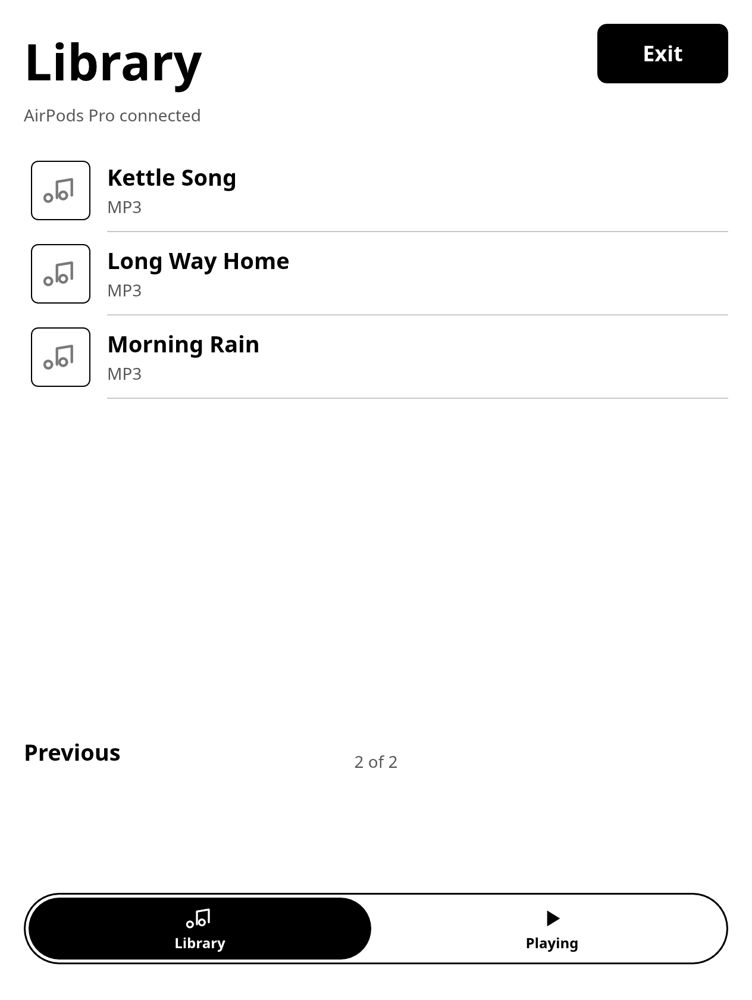

<div align="center">


# Music

**Play your Kindle's music through Bluetooth headphones.**
A native PrimitiveOS music player: a library, a player, a sound level, and a media card in quick settings, on grayscale e-ink.

[](https://github.com/PrimitiveOS/kindle-primitive-music/actions/workflows/ci.yml)
[](https://github.com/PrimitiveOS/kindle-primitive-music/releases)
[](https://github.com/PrimitiveOS/kindle-primitive-music/tags)
[](LICENSE)
[](https://github.com/PrimitiveOS/kindle-primitive-music/stargazers)
[](https://primitiveos.github.io/kindle-primitive-catalog/v1/index.json)

[**Download**](https://github.com/PrimitiveOS/kindle-primitive-music/releases/latest) ·
[**Install guide**](INSTALL.md) ·
[**Device notes**](docs/device-notes.md) ·
[**Changelog**](CHANGELOG.md)

</div>

---

Music is an app for [PrimitiveOS](https://github.com/PrimitiveOS/kindle-primitive), the app suite for jailbroken
Kindles. It plays the music files in your Kindle's user storage through the Bluetooth headphones connected in
Settings › Bluetooth. The Kindle has no speaker, so Music needs headphones. Playback keeps going when you leave the
app, and the media card in quick settings shows what is playing, with previous, play or pause, and next.

<table>
  <tr>
    <td align="center"><br><sub>The library</sub></td>
    <td align="center"><br><sub>The player, with the sound level</sub></td>
    <td align="center"><br><sub>The media card in quick settings</sub></td>
  </tr>
  <tr>
    <td align="center"><br><sub>The mini player</sub></td>
    <td align="center"><br><sub>Dark mode</sub></td>
    <td align="center"><br><sub>Pages of seven tracks</sub></td>
  </tr>
</table>

<sub>Screenshots are from the desktop previews of the same code, with sample track names. They are not photos of a device.</sub>

## Why this exists

The Kindle's own player plays only Audible and VoiceView, and it has no speaker. A music app has to bring its own
decoder, and then it has to keep playing while the reader is used for something else.

- **Headphones.** Music sends sound to connected Bluetooth headphones through the Kindle's stock audio manager.
- **Background play.** The player is a separate process. Leaving the app does not stop the music.
- **Controls everywhere.** The media card in quick settings controls playback from any app.

## Quick start

1. **Download** `primitive-music-<version>.zip` from the [latest release](https://github.com/PrimitiveOS/kindle-primitive-music/releases/latest), or open **Store** on the Kindle and find **Music**.
2. Connect your headphones in **Settings › Bluetooth**.
3. Copy music files to `/mnt/us/music` (or to `/mnt/us/music/library`) on the Kindle's user storage.
4. Open **Music** from the Launcher grid, and tap a track.

The [install guide](INSTALL.md) covers installation, updates and removal.

## Highlights

| | |
|---|---|
| 🎵 **Library** | Tracks sorted by title, seven to a page, with the file type under each title. |
| ▶️ **Player** | Pause and resume, previous and next, and a progress line you can tap to seek. |
| 🎚️ **Sound level** | Eight levels on the player and in quick settings. It is applied to the audio, so it works with any headphones. |
| 🎛️ **Media card** | Quick settings shows the track, its state and time, with previous, play or pause, and next. |
| 🔊 **Background play** | Exit leaves the app and the music keeps playing. Open Music again to see what is playing. |
| 🌙 **Dark mode** | White on black, following the system theme, like the rest of PrimitiveOS. |
| 🔋 **Sleep** | Sleeping the Kindle pauses playback, and the place is kept. |
| 🎼 **Formats** | MP3, FLAC, Ogg Vorbis, WAV, M4A and AAC, decoded on the Kindle. |

## Status

| Device | Status |
|---|---|
| Kindle Oasis 3 (1264 × 1680, firmware 5.18.2) | ✅ Playback heard through AirPods Pro; 🛠️ sound level, media card and background play under test |
| Other Kindle models | 🛠️ Not supported yet |

Music **0.1.0** is the first release. The [device notes](docs/device-notes.md) list the checks still to be done on
the Kindle.

## Limits

- Headphones are required. The Kindle has no speaker, and Music refuses to play without them.
- The sound level changes the audio before it is sent. A change in the middle of a track restarts that part, which
  gives a short pause, and the stock player also starts with a short gap at each 30-second segment.
- The Bluetooth stack sets its own level while headphones are connected, so the headphones' volume still sets the
  loudness on top of the Music level.
- Titles come from the file names; tags, playlists, shuffle and album art are not supported yet.
- Verified on the Oasis 3 only.

## Roadmap

- [x] M1: the library and the player (MP3, FLAC, Ogg, WAV, M4A, AAC) through the Kindle's stock player
- [x] M2: background play, with the player separate from the app; Stop and Exit
- [x] M3: the sound level, applied to the audio
- [x] M4: the media card in quick settings (the media session contract)
- [ ] M5: checks on the Kindle: sound level, media card, background play, sleep
- [ ] M6: Store listing and the first Store download
- [ ] M7: tags and playlists

<details>
<summary><b>Using Music</b></summary>

- **Library.** Tracks are listed by title. Tap one to play it. Tap the mini player to open the player.
- **Player.** Pause or resume with the round button. Previous and next move through the library and repeat from the
  start. Tap the progress line to seek. The eight segments under the controls set the sound level.
- **Exit and Stop.** Exit closes the app and the music keeps playing. Pausing stops the sound and keeps the place.
- **Quick settings.** While music plays, the media card shows the track and the controls. The Sound row shows the
  same level as the player.
- **Sleep.** Sleeping the Kindle pauses playback. Open Music to resume.
- **Files.** Music reads `/mnt/us/music` and `/mnt/us/music/library`. The place and the last track are kept in
  `/mnt/us/music/state.txt`.

</details>

<details>
<summary><b>Build from source</b></summary>

Requirements: Rust (stable), the `armv7-unknown-linux-musleabihf` target, [zig](https://ziglang.org) and
[cargo-zigbuild](https://github.com/rust-cross/cargo-zigbuild). Music builds against the PrimitiveOS tools, which
sit beside this checkout as `../doannt-kindle-tools`.

```sh
cargo test --locked --workspace
cargo run --locked -p music-desktop -- build/previews
cargo run --locked -p music-desktop -- listen <file> --pause-after 35
cargo zigbuild --locked --release -p music-kindle --target armv7-unknown-linux-musleabihf
sh scripts/stage.sh armhf
```

`listen` plays a file on the Mac through `afplay`, with the same segments and pause as the Kindle.

</details>

<details>
<summary><b>Tests and CI</b></summary>

```sh
cargo test --locked --workspace              # the library, the player, the audio, the screens, the media session
cargo clippy --locked --workspace --all-targets -- -D warnings
cargo test -p music-kindle --test player     # macOS only: the real player against silent audio
```

The [CI workflow](.github/workflows/ci.yml) runs the tests, clippy and the desktop previews on every push and pull
request. The [release workflow](.github/workflows/release.yml) builds and publishes the package when a `v*` tag is
pushed. The end-to-end player test runs on a Mac, because it needs `afplay`.

Desktop results are not hardware results. Each milestone is checked on the Kindle with the user watching.

</details>

<details>
<summary><b>Project structure</b></summary>

```text
crates/music-core     The library (which files are music), the queue, the saved place, the media session text
crates/music-audio    Decoding (Symphonia) and the segment player (mplay on the Kindle, afplay on a Mac)
crates/music-render   The screens, the touch handling and the playback control, as a remote for the player
crates/music-kindle   The device binary: the player process, the app's side of it, and the sound level
crates/music-desktop  Screen previews and the listening test on a computer
deploy/               The library entry (Music.sh), with its icon in light and dark forms
scripts/              Packaging
assets/               The app icon
docs/                 Device notes and the images
```

</details>

## Documentation

- 📘 [Install guide](INSTALL.md)
- 🔬 [Device notes](docs/device-notes.md)
- 📝 [Changelog](CHANGELOG.md)
- 🔗 [Media session contract](https://github.com/PrimitiveOS/kindle-primitive/blob/feature/system-architecture/docs/contracts.md) (§1.2): how quick settings shows the media card

## Downloads

The badge at the top shows the number of Store downloads. It counts GitHub downloads of this app's release packages,
across all versions and architectures, and is refreshed daily from the [Store catalog](https://primitiveos.github.io/kindle-primitive-catalog/v1/index.json).

## Licence

Copyright (C) 2026 Doan Nguyen.

- **App code** in `crates/`, `deploy/` and `scripts/` is under the [PolyForm Noncommercial License 1.0.0](LICENSE).
  You may use, change and share it for any non-commercial purpose. Commercial use needs the author's written permission.
- **Documentation and pictures** (this README, `docs/`, the icon and the screenshots in `assets/` and `docs/images/`):
  [CC BY-NC-SA 4.0](LICENSE-DOCS).

Decoding uses [Symphonia](https://github.com/pdeljanov/Symphonia), licensed under the Mozilla Public License 2.0.
Kindle is a trademark of Amazon.com, Inc. or its affiliates. This project is not affiliated with or endorsed by Amazon.

## Security

Report security problems privately to the maintainer rather than in a public issue.
